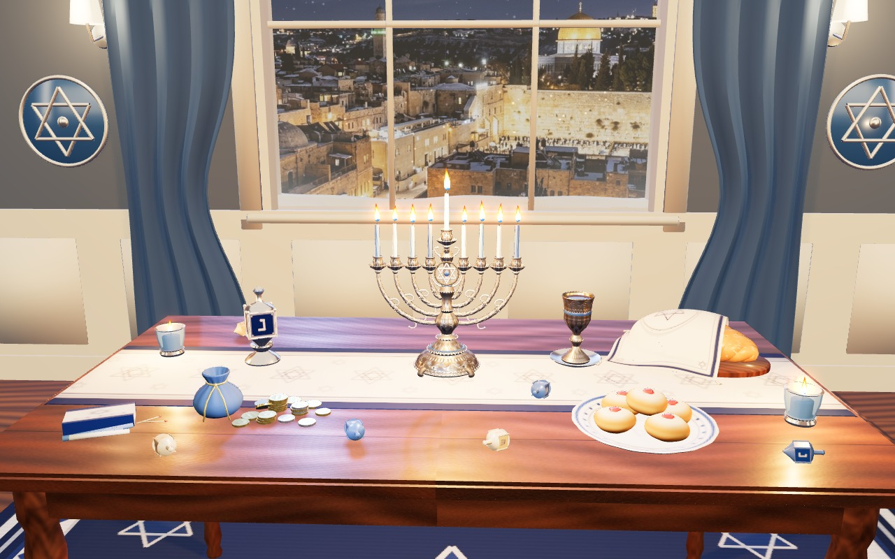
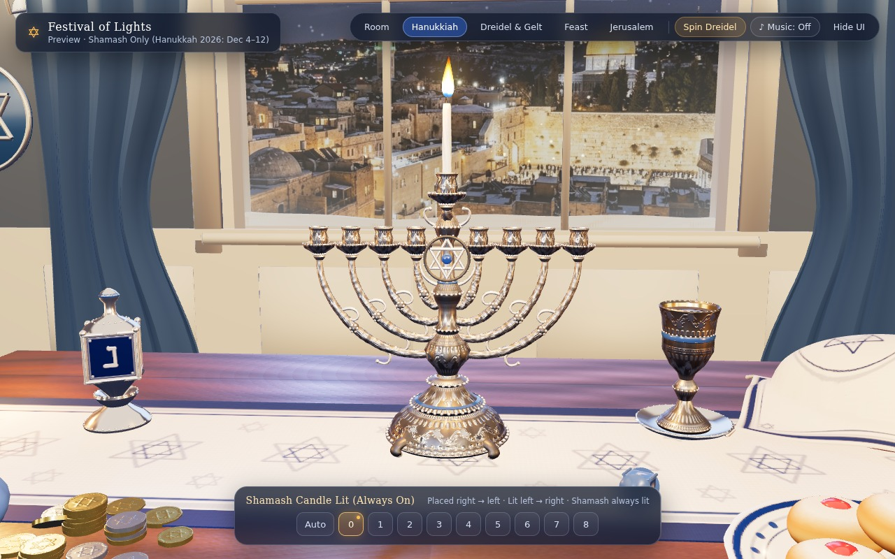
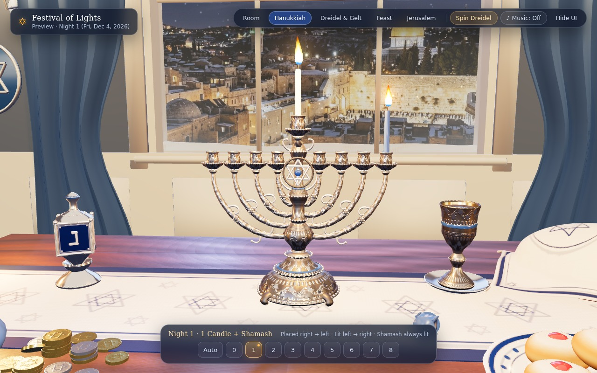

# Hanukkah 3D — Festival of Lights

### **[Launch the Live 3D Hanukkah Room → https://jaher.github.io/hanukkah-3d/](https://jaher.github.io/hanukkah-3d/)**

A photorealistic, interactive **Three.js** Hanukkah room featuring a deeply carved 925 sterling silver nine-branched *hanukkiah* (menorah), traditional Judaica modeled in headless Blender, live animated candlelight, a photorealistic winter night view of Jerusalem's Old City through the window, traditional Hanukkah music, and automatic night-by-night lighting for **Hanukkah 2026 (December 4–12)**.



---

## Night-by-Night Lighting (Hanukkah 2026: Dec 4–12)

The site computes the active night automatically from the current date (Night 1 beginning the evening of **Friday, Dec 4, 2026** through Night 8 on **Friday, Dec 11**, ending at nightfall on **Saturday, Dec 12**). Per tradition:

- The raised central ***shamash*** stays lit at all times.
- On Night *N*, *N* candles are placed **right-to-left** and ignited sequentially **left-to-right** (starting from the newest leftmost candle).
- Use the on-screen night selector (`Auto`, `0`, `1`–`8`) or keys `0`–`8` to preview any night.

| Shamash Only (Always Lit) | Night 1 — Fri, Dec 4 (Far Right + Shamash) |
| :---: | :---: |
|  |  |

| Night 5 — Tue, Dec 8 (5 Candles Right-to-Left + Shamash) | Night 8 — Fri, Dec 11 (All 8 Candles + Shamash) |
| :---: | :---: |
|  |  |

---

## Room Views & Traditional Judaica

Every prop in the room was modeled in headless Blender (`scripts/blender/`) with PBR materials and tangent-space normal maps, exported to `.glb`, paired with Cycles-baked GI/AO architectural lightmaps, and rendered live in WebGL via Three.js.

| Dreidels, Embossed Chocolate Gelt & Velvet Pouch | Sufganiyot, Carved Kiddush Cup & Braided Challah |
| :---: | :---: |
|  |  |

### Jerusalem Old City Winter Night Window


---

## Features

- **Carved 925 Sterling Silver Hanukkiah**: Stepped gadrooned domed pedestal on four baroque scrolled acanthus feet, repoussé floral & grapevine chasing with dark oxidized patina crevices, spiral-roped branches, double-tier filigree scrollwork, floral rosettes, scalloped bobeches, unobstructed 3D Star of David crest with sapphire cabochon, and a distinctly elevated *shamash*.
- **Photorealistic Fire & Lighting**: Custom GLSL teardrop flame shader with subtle translucent blue combustion base, incandescent core, golden-amber flickering tip, soft additive glow halos, and shadow-casting flickering dynamic point lights.
- **Interactive Controls**:
  - **Orbit & Zoom**: Smooth damped camera controls with 5 curated viewpoints (`Room`, `Hanukkiah`, `Dreidel & Gelt`, `Feast`, `Jerusalem`).
  - **Interactive Dreidels (Tilted at Rest → Upright Spin → Sideways Topple)**: Six blue and carved wooden dreidels rest naturally tilted on their sides across the walnut table (as if mid-game) alongside the heirloom filigree dreidel; click any playable dreidel (or press `Space` / **Spin Dreidel**) to lift it upright onto its tip, spin briskly, wobble as it loses momentum, and topple back onto its side with the winning Hebrew letter (**נ Nun**, **ג Gimel**, **ה Hey**, or **ש Shin**) facing up.
  - **Subtle Traditional Hanukkah Music**: Built-in polyphonic Web Audio synthesizer playing public-domain arrangements of *Ma'oz Tzur*, *The Dreidel Song*, and *Hanukkah, Oh Hanukkah* with warm room reverb at a subtle background volume—starts automatically on your first click/tap anywhere on the page, with a clear **♪ Music: On / Off** control (`M` key) and next-track switcher (`⏭`).
  - **Gated Loading with Cancel / Retry**: The scene remains hidden until all 18 required `.glb` models, metadata, and lightmaps finish loading, backed by real `AbortController` cancellation and clean retry.
  - **Keyboard Shortcuts**: `0`–`8` select night, `A` returns to Auto calendar mode, `R` resets camera, `Space` spins a dreidel, `M` toggles music, `H` toggles the HUD.

## Local Development

Zero build step — static HTML/CSS/ES modules loading Three.js via CDN import map:

```bash
python3 -m http.server 8080
```

Open `http://localhost:8080` in your browser. To refresh all README screenshots after visual changes:

```bash
python3 scripts/capture_screenshots.py
```
